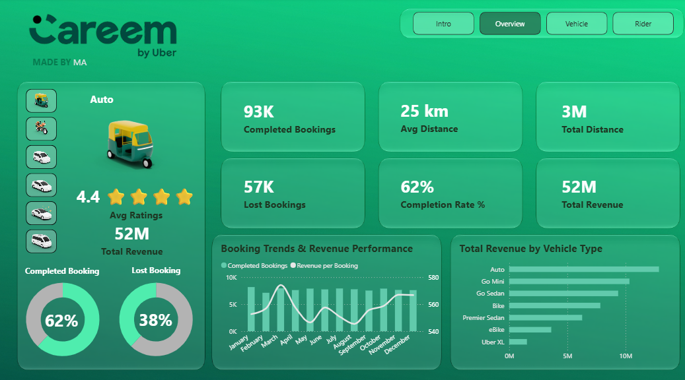
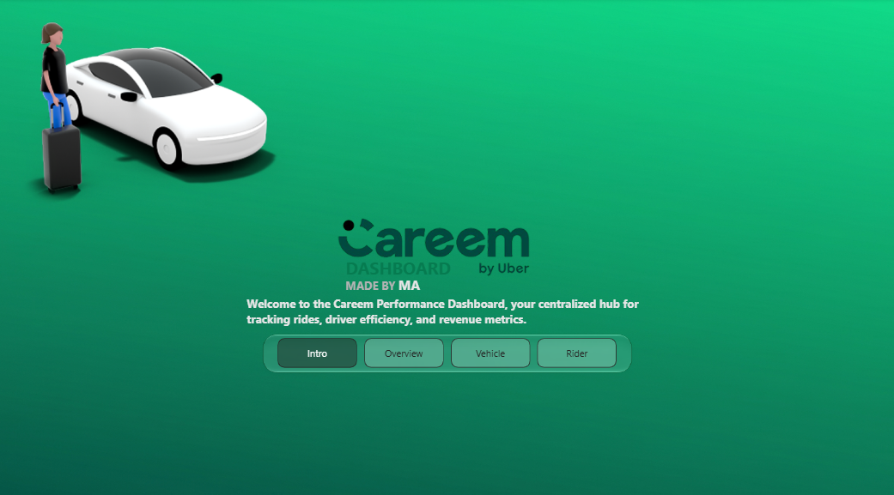
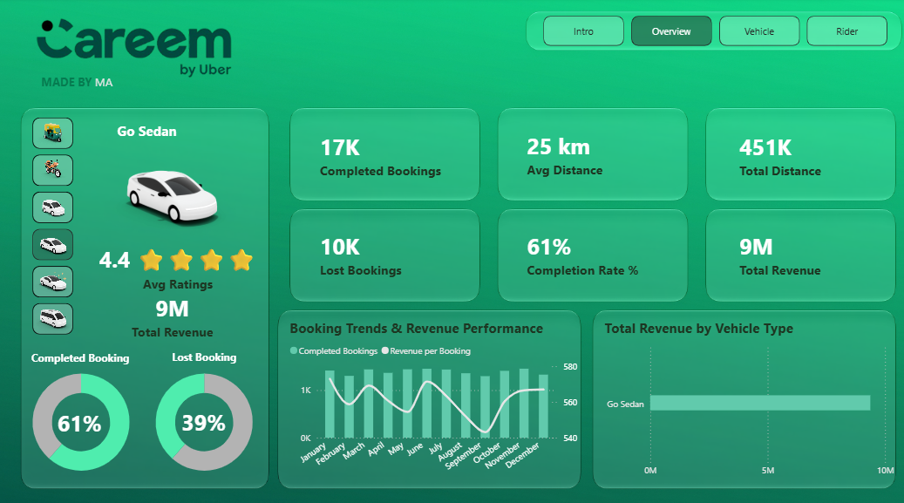
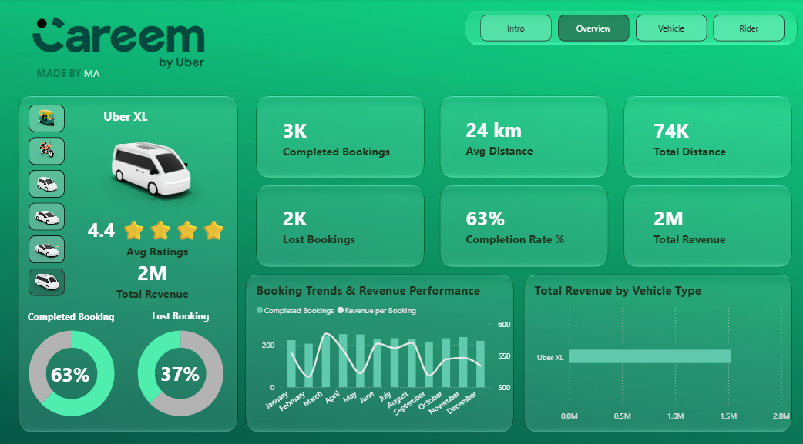
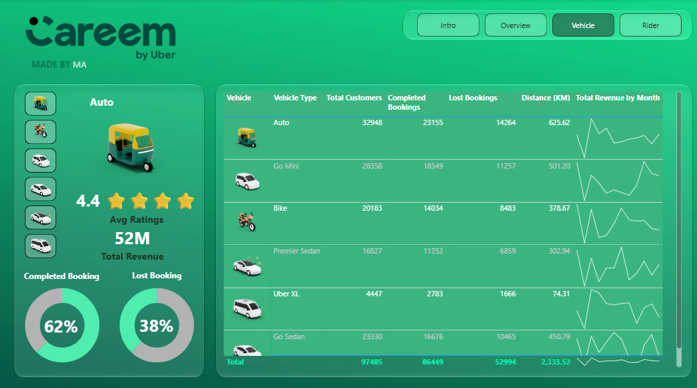
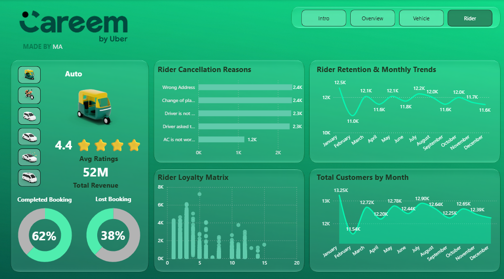

# Careem Interactive Performance Dashboard

An enterprise-grade, vibrant brand-themed **Ride-Hailing Performance Dashboard** designed inside **Power BI**. This analytics platform tracks rides, driver efficiencies, vehicle logistics, and transactional trends for Careem (by Uber), transforming raw dispatch logs into high-impact operational insights.

---

## 🚀 Live Dashboard Preview

### 🏠 Comprehensive System Overview
<p align="center">
  
</p>

### 📊 Modular Views Breakdown
<p align="center">
  
  
</p>
<p align="center">
  
  
</p>
<p align="center">
  
</p>

---

## 📊 Key Features & Interactive Views

The application uses an interactive top-right bookmark layout (**Intro, Overview, Vehicle, Rider**) configured alongside a dynamic vehicle selection matrix panel:

* **Brand-Cohesive UI Design:** Engineered with Careem's distinctive signature green palette, modern rounded card layouts, and premium 3D vehicle asset graphics.
* **Macro Operational KPIs:** Highlights cross-franchise absolute metrics across the platform:
  * **Total Revenue:** $52M
  * **Completed Bookings:** 93K (Overall 62% Completion Rate)
  * **Lost/Canceled Bookings:** 57K (Overall 38% Loss Rate)
  * **Distance Traveled:** 25 km Avg Distance | 3M Total Distance
* **Granular Fleet Analytics (Vehicle Tab):** Evaluates separate vertical segments (**Auto, Go Mini, Bike, Premier Sedan, Uber XL, Go Sedan**) against total client count, total distance (KM), and revenue charts by month.
* **Rider Behavior & Retention (Rider Tab):**
  * **Cancellation Root Causes:** Visualizes reasons behind ride drops (e.g., *Wrong Address*, *Change of plans*, *Driver asked to cancel*).
  * **Rider Retention Trends:** Line charts monitoring performance stability and user frequency month-over-month.
  * **Loyalty Matrix:** Deep scatter index tracking structural consumer habits.

---

## 🧮 Tech Stack & Engineering Principles

* **Business Intelligence Tool:** Power BI Desktop
* **Data Pipelines:** Power Query handling extraction, structured data cleaning, null handling for lost bookings, and relational schema optimization.
* **Analytical Expressions:** Advanced context-driven DAX calculations powering dynamic ratings averages, performance completion percentages, and multi-tier vehicle filtering parameters.

---

## ⚙️ How to View the Project

1. **Clone the Repository:**
   ```bash
   git clone [https://github.com/M-Awad-27/Careem-Interactive-Dashboard.git](https://github.com/M-Awad-27/Careem-Interactive-Dashboard.git)
2.**Open in Power BI:**
      Ensure you have Power BI Desktop installed.
Open the Dunkins Dashboard.pbix file included in this repository.

3.**Explore the Insights:**
                     Click through the Intro, Overview, and Details navigation tabs at the top right of the application layout to dynamically slice the operational data.
## 🤝 Contributing
Feedback, issues, and aesthetic enhancement requests are always welcome! Feel free to open an issue or submit a pull request.

## 📝 License
This project is open-source and available under the MIT License.

## 👨‍💻 Author

<h1 align="center">
  🍁 Made by <span style="color: #FF0055;">M</span><span style="color: #00E5FF;">A</span> 🍁
</h1>
